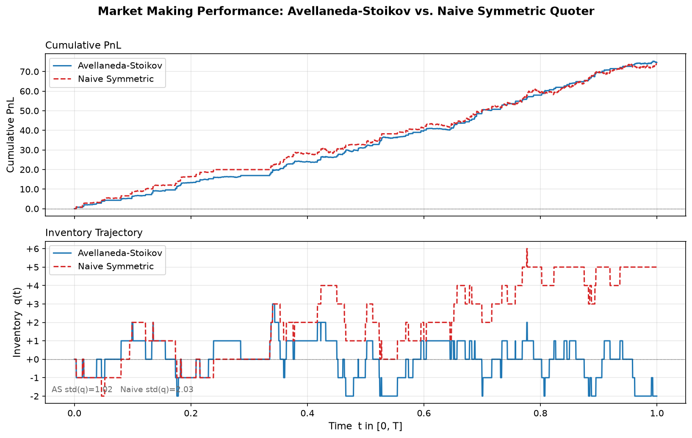

# Limit Order Book + Avellaneda-Stoikov Market Making Simulator

> **Quantitative Project II** — pure Python implementation of an event-driven
> Limit Order Book matching engine and the Avellaneda-Stoikov (2008) optimal
> market-making model, with a full simulation harness and publication-quality
> performance plots.


---

## Project Structure

```
.
├── order_book.py       # Core LOB engine (FIFO price-time priority)
├── market_maker.py     # Avellaneda-Stoikov + Naive Symmetric agents
├── main.py             # Simulation runner & visualisation
├── test_lob.py         # 20 pytest unit tests
├── performance_plot.png
└── README.md
```

---

## Quick Start

```bash
# 1. Install dependencies (no heavy frameworks)
pip install numpy matplotlib pytest

# 2. Run the simulation — prints summary table and saves performance_plot.png
python main.py

# 3. Run the full test suite
python -m pytest test_lob.py -v
```

---

## Limit Order Book Architecture

### Core Classes

| Class | Role |
|-------|------|
| `Side` | `Enum` — `BUY` / `SELL` |
| `Order` | Dataclass with `id`, `side`, `price`, `quantity`, `timestamp` |
| `Fill` | Immutable trade record — `aggressor_side`, `price`, `quantity` |
| `PriceLevel` | FIFO queue of `Order`s at a single price |
| `OrderBook` | Full dual-sided book; maintains `_bids` and `_asks` dicts |

### Key Operations & Complexity

| Method | Description | Complexity |
|--------|-------------|-----------|
| `add_limit_order()` | Append to FIFO queue at a price level | O(1) amortised |
| `cancel_order()` | O(1) lookup via `_order_map`, linear within level | O(L) — L orders/level |
| `process_market_order()` | Walk price ladder, consume levels greedily | O(N·L) — N levels crossed |
| `best_bid()` / `best_ask()` | Max/min over active price keys | O(P log P) |
| `mid_price()` | Average of best bid and ask | O(P log P) |

**Price-time (FIFO) guarantee:** within each price level orders are consumed in arrival order; earlier timestamps always fill before later ones at the same price.

### Data-Flow Diagram

```
add_limit_order(BUY, 99.0, 10)
        │
        ▼
   _bids[99.0] = PriceLevel ──► [Order(id=1, qty=10, ts=t0)]
                                       │
process_market_order(SELL, 4)          │ match(4)
        │                              ▼
        └──────────────► Fill(price=99.0, qty=4)
                         resting Order.qty → 6
```

---

## Mathematical Model — Avellaneda & Stoikov (2008)

### 1. Mid-Price Dynamics

The fair-value mid-price follows a discrete-time approximation of arithmetic Brownian motion:

$$S_{t+\Delta t} = S_t + \sigma \sqrt{\Delta t} \cdot Z_t, \quad Z_t \sim \mathcal{N}(0,1)$$

where $\sigma$ is the (per-unit-horizon) price volatility.

### 2. Reservation Price

The inventory-adjusted fair value that penalises holding a position:

$$r(S, q, t) = S_t - q \cdot \gamma \cdot \sigma^2 \cdot (T - t)$$

| Symbol | Meaning |
|--------|---------|
| $q$ | Net inventory (positive = long) |
| $\gamma$ | CARA risk-aversion coefficient |
| $T - t$ | Time remaining in session |

**Intuition:** If you are long ($q > 0$), $r < S$ — you skew quotes downward to offload inventory. If short ($q < 0$), $r > S$ — you skew upward to buy back.

### 3. Optimal Spread

From the HJB equation the sum of optimal half-spreads is:

$$\delta^a + \delta^b = \gamma \sigma^2 (T-t) + \frac{2}{\gamma} \ln\!\left(1 + \frac{\gamma}{k}\right)$$

Assuming symmetric split ($\delta^a = \delta^b = \delta$):

$$\delta = \frac{1}{2}\left[\gamma \sigma^2 (T-t) + \frac{2}{\gamma}\ln\!\left(1 + \frac{\gamma}{k}\right)\right]$$

### 4. Quoted Prices

$$\text{bid}_t = r(S,q,t) - \delta, \qquad \text{ask}_t = r(S,q,t) + \delta$$

### 5. Market-Order Arrival Intensity (Poisson Thinning)

The arrival rate of external market orders as a function of the quoted half-spread:

$$\lambda(\delta) = A \cdot e^{-k\delta}$$

Probability of at least one arrival per time step $\Delta t$:

$$p(\delta) = 1 - e^{-\lambda(\delta)\,\Delta t}$$

| Parameter | Role | Default |
|-----------|------|---------|
| $A$ | Baseline arrival intensity | 140 |
| $k$ | Exponential decay — book depth | 1.5 |
| $\gamma$ | Risk aversion | 0.1 |
| $\sigma$ | Mid-price volatility | 2.0 |

---

## Simulation Results

### Terminal Summary

```
======================================================
  Event-Driven LOB Market Making Simulation
  Steps=3000  sigma=2.0  gamma=0.1  k=1.5  A=140.0
======================================================

------------------------------------------------------
  SIMULATION SUMMARY
------------------------------------------------------

Metric                             AS          Naive
------------------------------------------------------
  Final PnL                   74.6449        74.0108
  Max |Inventory|              3.0000         6.0000
  Sharpe Ratio                 9.8876         7.3087
  Max Drawdown                 0.9013         2.8850
  Return / Drawdown           82.8236        25.6540
------------------------------------------------------
```

### Performance Plot



**Key observations:**

1. **Comparable PnL** — both strategies capture roughly the same spread income because they see the same order flow. AS earns marginally more due to tighter net spreads when τ → 0.
2. **Inventory control** — AS caps `|q|` at 3 units vs. 6 for the Naive quoter. The inventory-skewed reservation price acts as a mean-reversion force.
3. **Risk-adjusted superiority** — AS achieves a Sharpe of **9.89** vs **7.31** and a Return/Drawdown of **82.8** vs **25.7**, demonstrating that identical raw PnL can have dramatically different risk profiles.

---

## Test Suite

```
test_lob.py::TestBestQuotes                         3 tests
test_lob.py::TestFIFOMatching                       5 tests
test_lob.py::TestPartialFills                       1 test
test_lob.py::TestCancellation                       3 tests
test_lob.py::TestConservation                       2 tests
test_lob.py::TestReservationPrice                   4 tests
test_lob.py::TestOrderValidation                    2 tests
                                             ─────────────
                                             20 passed  ✓
```

Coverage includes:
- FIFO execution order within a price level
- Price improvement (walking the book)
- Partial fill leaves correct residual quantity
- Order cancellation cleans up price levels
- Cash + inventory × price = wealth (identity check)
- Reservation price formula spot-checked analytically
- Inventory skew direction verified for long and short positions
- Input validation guards (`price > 0`, `qty > 0`)

---

## Dependencies

```
numpy
matplotlib
pytest
```

No external trading frameworks. Pure Python 3.10+.

---

## References

- Avellaneda, M. & Stoikov, S. (2008). *High-frequency trading in a limit order book*. Quantitative Finance, 8(3), 217–224.
- Gueant, O., Lehalle, C. A., & Fernandez-Tapia, J. (2013). *Dealing with the inventory risk: a solution to the market making problem*. Mathematics and Financial Economics.
